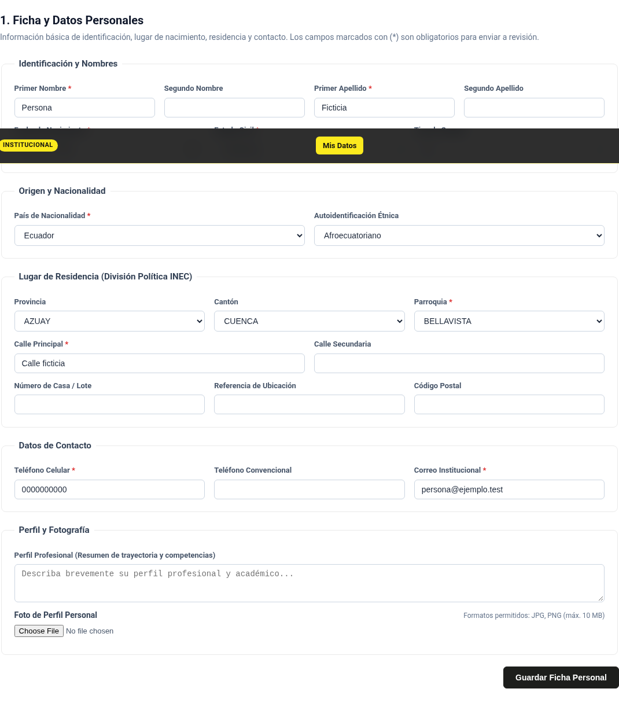
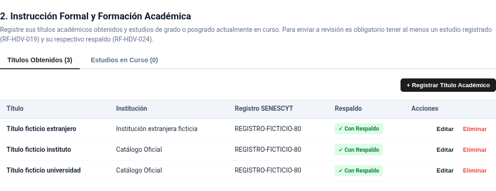
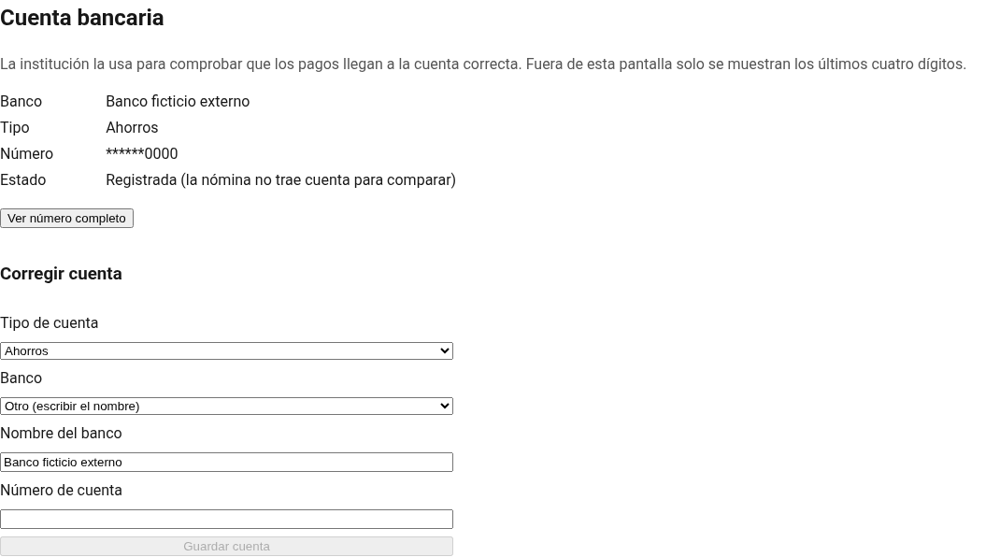

# Evidencia del issue #80 — Tipos y catálogos completos

Fecha: 2026-10-26. Spec-0004 v0.1 y ampliación v0.2 aprobadas explícitamente en esta conversación. Rama `feature/80-semillas-tipos-institucionales`; PR #91 hacia `develop`. Se incorporó `origin/develop` (`1752d00`) sin conflictos mediante merge, sin reescribir historial.

## Resultado ejecutado sobre el alcance completo

| Comprobación | Salida real |
|---|---|
| `dotnet build src/Backend` | `Build succeeded. 0 Warning(s). 0 Error(s).` |
| `dotnet test src/Backend --no-build -- RunConfiguration.MaxCpuCount=1` | Application: **13**; Domain: **102**; WebApi: **258**. Total **373 aprobadas, 0 fallidas, 0 omitidas**, incluidas las de integración con PostgreSQL 17 mediante Testcontainers. |
| Pruebas de catálogos y contrato OpenAPI | **36 aprobadas**: carga completa, repetición, archivos ausentes, hashes, CSV inválidos, padres, preservación y validación Production. |
| `dotnet format src/Backend --verify-no-changes --no-restore` | Código 0, sin diferencias. |
| `corepack pnpm --dir src/Frontend test:ci` | **30 archivos, 196 pruebas aprobadas**. |
| `corepack pnpm --dir src/Frontend build` | Compilación de producción correcta. Cuatro avisos de presupuesto de estilos existentes; ningún error. |
| `corepack pnpm --dir src/Frontend lint` | `All files pass linting.` |
| `corepack pnpm --dir src/Frontend format:check` | `All matched files use Prettier code style!` |
| `docker build -f src/Backend/Dockerfile -t actualizacion-datos-backend:issue-80 .` | Imagen construida correctamente, etiqueta de prueba local. |
| actionlint y shellcheck con las imágenes fijadas en CI | Código 0 y sin diagnósticos. |
| Pruebas de scripts de ramas y filtro por rutas | **55 y 15 casos correctos**, respectivamente. Los cambios de CSV y `.dockerignore` disparan backend/OpenAPI. |
| OpenAPI y NSwag durante compilación Debug | Regenerados sin diferencias de contrato ni cliente. |
| `git diff --check` | Sin errores. |

Entorno: SDK .NET 10.0.402, Node 22.23.3, pnpm 12.4.1 mediante Corepack. La primera ejecución conjunta de backend se abortó por cierre del proceso de pruebas; se repitió y la ejecución completa terminó con las 373 pruebas aprobadas. No se omiten pruebas ni checks.

Auditoría ejecutada durante v0.1, con las mismas dependencias: NuGet sin paquetes vulnerables; frontend sin altas/críticas, con dos bajas y dos moderadas. No se añaden dependencias al producto.

## Semillas institucionales: RF-TIP-001 a 006

- Alta HTTP con dos funcionarios y seis documentos, instrucciones, vencimientos y órdenes aprobados; ningún requisito creado automáticamente.
- Doble semilla antes y después de guardar: conserva ids, personalizaciones y desactivaciones. Otra institución permanece aislada.
- Trigger SQLite que rechaza la inserción de documentos: se revierten institución, administradores, auditoría y tipos.
- PostgreSQL real: institución parcial y otra vacía antes de la migración, ejecución del SQL dos veces y reversión/reaplicación; mismos ids y valores conservados. El alta y la migración producen la misma lista.
- Formulario sin check ni columna docente; edición y desactivación conservan `EsDocente`. Orden sugerido máximo más uno, incluidos inactivos, recarga asíncrona, edición y lista vacía. Las tres regresiones originales fallaron antes de corregirse.
- ADR-0019/0020 vigentes y etiqueta `decision` en #80. #81 ya estaba cerrado por unificación.

## Recorrido real de v0.2: RF-CAT-001 a 010

Ejecutado con `scripts/verificar-catalogos-produccion.mjs`: imagen Release del backend, PostgreSQL 17 recién creado, distribución Angular de producción y Chromium. **Sin interceptar ni simular la API**. El script elimina sus contenedores y red efímeros al terminar. No usa `.env`, servidores, claves ni datos personales de producción.

Salida final:

```text
V-06/07: imagen con 17 CSV, Production incompleta rechazada, 2350 elementos, doble carga e inactivo conservado.
V-08: país, etnia y cascada geográfica; ficha guardada en PostgreSQL.
V-09: 280 IES; tres títulos con respaldo y UNESCO guardados y recuperados; becas disponibles.
V-10: 28 bancos y 2 tipos, componente con API real; banco de catálogo y escrito, número enmascarado. Sin errores de página.
```

- **V-06/07:** verifica los 17 CSV dentro de la imagen, migra una base vacía y demuestra que Production rechaza iniciarse antes de cargar catálogos. Ejecuta `--cargar-catalogos` dos veces, compara cantidad y huella de ids/códigos, y conserva una etnia desactivada. Comprueba 2350 elementos y los 21 tipos con activos. Las pruebas SQLite/PostgreSQL complementan errores de hash, archivo ausente, padre inexistente y archivo parcialmente inválido; el lote se recupera al repetirlo.
- **V-08:** login real de persona ficticia, cambio de clave inicial, campaña ficticia abierta, selección de país, etnia, provincia → cantón → parroquia; guardado de ficha y consulta real de ids persistidos. Se corrigió la búsqueda de Ecuador por id fijo 601 para usar su código estable `218`.
- **V-09:** 280 IES (64 universidades y 216 institutos). Guarda tres títulos de tercer nivel, con universidad, instituto y otra institución extranjera ficticia, campos UNESCO dependientes, registro y PDF ficticios; recarga y comprueba los tres respaldos/ids. Guarda también un estudio con beca y financiamiento y comprueba sus valores persistidos.
- **V-10:** componente bancario existente conectado a la ficha; muestra 28 bancos y dos tipos de cuenta. Guarda desde el formulario una cuenta ficticia con banco del catálogo y otra con banco escrito, recarga y comprueba la máscara. Capacitación tiene sus opciones.
- **V-11:** nuevos datos con fuente oficial y hashes en `fuentes.json`; ADR-0021/0022 aprobados antes de implementar. La distribución contiene datos y manifiesto; no descarga fuentes durante el arranque. No cambia el contrato HTTP ni los permisos.

El recorrido real detectó que DateOnly se enviaba como fecha con hora y daba 400. `fecha-sin-hora.ts` corrige los seis controles de fechas de la hoja de vida sin cambiar DateTime de campañas. Su prueba verifica ambos formatos. También se conectaron los campos UNESCO y de becas ya contemplados en los contratos; no se añadieron reglas de negocio.

Para reproducir, desde la raíz, con Docker y Node compatibles:

```bash
docker build -f src/Backend/Dockerfile -t actualizacion-datos-backend:issue-80 .
corepack pnpm --dir src/Frontend build
npm install --prefix /tmp/issue-80-navegador --no-audit --no-fund playwright@1.64.1
/tmp/issue-80-navegador/node_modules/.bin/playwright install chromium
PLAYWRIGHT_MODULO=/tmp/issue-80-navegador/node_modules/playwright/test node scripts/verificar-catalogos-produccion.mjs
```

En esta ejecución se usó un Chromium previamente instalado mediante `NAVEGADOR_PRUEBA`; el script admite esa ruta opcional. Playwright queda fuera del proyecto y no cambia sus dependencias. No ejecutar el script sobre una base real: siempre crea su propia PostgreSQL y red.

## Capturas de v0.2 con API real y datos ficticios







Las capturas originales `issue-80/funcionarios.png` y `documentos.png` documentan la interfaz de v0.1 con API simulada; no sustituyen este recorrido real.

## Integración

No se ejecutó ningún despliegue real. La integración del PR #91 y el cierre de #80 están autorizados tras confirmar criterios, ausencia de conflictos y checks aplicables correctos sobre el HEAD final. La autoaprobación se intentará sin comentario; si GitHub rechaza que el autor se apruebe, se registrará esa limitación en la respuesta final.
