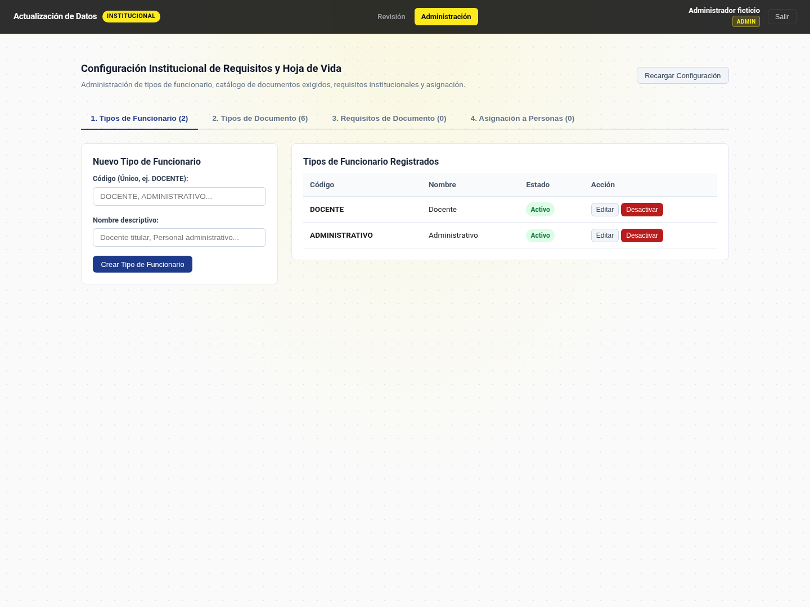
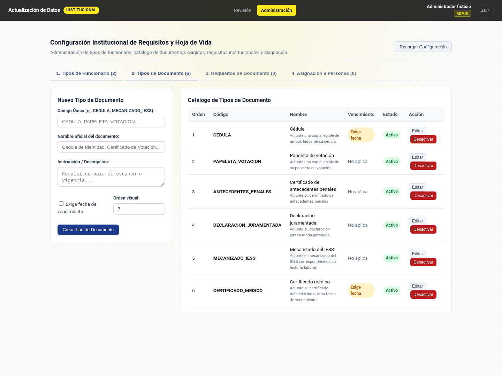

# Evidencia del issue #80 — Tipos institucionales

Fecha: 2026-10-26. Spec aprobada: spec-0004 v0.1. Código verificado: commit `74d377d`, con backend en `ac22381`. Rama: `feature/80-semillas-tipos-institucionales`, desde `develop` (`48d6e54`). Los commits posteriores de documentación no cambian el código probado.

## Resultados ejecutados

| Comando / recorrido | Resultado real |
|---|---|
| `dotnet build src/Backend` | `Build succeeded. 0 Warning(s). 0 Error(s).` |
| `dotnet test src/Backend --no-build` | Application: 13; Domain: 102; WebApi: 253. Total: **368 aprobadas, 0 fallidas, 0 omitidas**, incluidas las de integración con PostgreSQL 17 mediante Testcontainers. |
| `dotnet test src/Backend --filter FullyQualifiedName~SemillaTiposInstitucionales` | **5 aprobadas, 0 fallidas, 0 omitidas**: alta, repetición y personalización, reversión atómica, HTTP y migración real. |
| `dotnet format src/Backend --verify-no-changes --no-restore` | Salida vacía; código de salida 0. |
| `corepack pnpm --dir src/Frontend test:ci` | **29 archivos y 192 pruebas aprobadas**. |
| Pruebas del componente antes de corregirlo | **3 fallidas y 6 aprobadas**: control docente visible, orden inicial incorrecto y falta de recálculo. |
| Pruebas del componente después de corregirlo | **9 aprobadas**. |
| `corepack pnpm --dir src/Frontend build` | Compilación de producción correcta. Cuatro avisos por presupuesto de estilos en componentes existentes de hoja de vida, supervisor, admin y usuario; ningún error. |
| `corepack pnpm --dir src/Frontend lint` | `All files pass linting.` |
| `corepack pnpm --dir src/Frontend format:check` | `All matched files use Prettier code style!` |
| `corepack pnpm --dir src/Frontend audit --audit-level=high` | Código 0; cuatro vulnerabilidades de severidad inferior al umbral: dos bajas y dos moderadas. No se modificaron dependencias. |
| `dotnet list src/Backend package --vulnerable --include-transitive` | Ningún paquete vulnerable en los siete proyectos según las fuentes consultadas por NuGet. |
| Regeneración OpenAPI/NSwag durante compilación Debug | Sin diferencias en `openapi/v1.json` ni en el cliente Angular; no cambia el contrato. |
| Recorrido Chromium sobre Angular servido localmente | Control y columna docente ausentes; seis documentos; orden inicial 7; alta de documento ficticio y nuevo orden 8; sin errores de página. API simulada con interceptación de peticiones, no una conexión contra el backend. |
| `git diff origin/develop --check` | Sin errores de espacios en los cambios. |

Entorno: .NET SDK 10.0.402, Node 22.23.3 y pnpm 12.4.1 mediante Corepack. No había ejecutable directo de pnpm; se usó `corepack pnpm` con la versión fijada por el proyecto. Se restauraron las dependencias del backend y frontend tras actualizar `develop`.

## Cobertura de los criterios

- **V-01 / RF-TIP-001:** el alta HTTP de una institución devuelve los tipos base. Los tests de persistencia verifican nombres, instrucciones, vencimientos, órdenes y ausencia de requisitos automáticos. Un trigger SQLite que rechaza la inserción de documentos demuestra que se revierten institución, administradores, auditoría y tipos.
- **V-02 / RF-TIP-002 y 003:** el helper se ejecuta dos veces antes de guardar y otra después; no duplica ni cambia los tipos personalizados o inactivos. La consulta usa un contexto de otra institución para verificar el alcance explícito. PostgreSQL migra desde `AgregarCuentaBancaria` con un catálogo parcial y otro vacío, aplica la nueva migración, repite su SQL real y revierte/reaplica. Los identificadores no cambian; el alta nueva y la migración producen los mismos valores. El filtro institucional conserva el aislamiento.
- **V-03 / RF-TIP-004:** Vitest comprueba máximo más uno con órdenes 1, 4 y 7, incluido el inactivo; cancelación; lista vacía; edición que conserva 4; dos altas con recarga asíncrona. Chromium verifica visualmente el orden 7 y el siguiente 8.
- **V-04 / RF-TIP-005:** el DOM no contiene el check ni la cabecera docente. Las solicitudes de edición y desactivación preservan `EsDocente = true`; una creación manual envía `false`. La prueba HTTP edita y desactiva los tipos sembrados.
- **V-05 / RF-TIP-006:** ADR-0019 y ADR-0020 registrados después de la aprobación funcional explícita de spec v0.1 y antes de sus tareas. El issue #80 tiene la etiqueta `decision`; #81 ya estaba cerrado por unificación.

## Capturas con datos ficticios

Se capturaron sobre la aplicación Angular real, con respuestas API simuladas y sin datos personales reales. No son evidencia de carga de catálogos globales en producción.

## Integración

La integración queda condicionada a revisar conflictos y el CI del HEAD final. La propuesta posterior de ampliar los catálogos globales de producción en el comentario del issue se consulta por separado: no está incluida en spec-0004 v0.1 ni se presenta como implementada por estas pruebas.
